# INFORME FINAL DEL PROYECTO DE BASE DE DATOS II

**Implementación y administración de base de datos utilizando Oracle Database**

---

## PORTADA

- **Institución:** Universidad Peruana Unión — Sede Juliaca
- **Programa de Estudios:** Escuela Profesional de Ingeniería de Sistemas
- **Asignatura:** Administración de Base de Datos II
- **Título del Proyecto:** Clínica Dent — Sistema de Gestión Integral para un Centro Odontológico
- **Equipo:** InnovateX *(IV Ciclo, Semestre 2026-II, Sección G-2, Grupo 8)*
- **Integrantes y Módulos del Sistema:**
  - **Eddy Brayan Huaman Taco** *(Módulo 1: Admisión y Citas)*
  - **Paul Cariapaza Sacachipana** *(Módulo 2: Catálogo y Tratamientos)*
  - **Erick Midwar Calsin Chura** *(Módulo 3: Atenciones Clínicas)*
  - **Axcel Daniel Vargas Quispe** *(Módulo 4: Pagos y Caja)*
- **Docente Responsable:** Eder Gutiérrez Quispe
- **Lugar y Fecha:** Juliaca, 20 de noviembre de 2026

---

## I. RESUMEN EJECUTIVO

**Clínica Dent** centraliza la gestión operativa y financiera de un centro odontológico integrando cuatro módulos principales: **Admisión y Citas**, **Catálogo y Tratamientos**, **Atenciones Clínicas** y **Pagos y Caja**, junto con un módulo transversal de **Auditoría**. El sistema permite rastrear el recorrido completo del paciente desde que agenda una cita hasta que liquida su plan de tratamiento con múltiples medios de pago.

La aplicación está desarrollada con **Angular**, **Spring Boot** y **Oracle Database**. Las pruebas de administración de base de datos se ejecutaron sobre **Oracle AI Database 26ai Free (versión 23.26.3)** en contenedor Docker (`clinicadent-oracle`, PDB `FREEPDB1`) administrado desde **Oracle SQL Developer**.

Manteniendo intacto el esquema en producción de la aplicación (`CLINICADENT_APP`), se replicó el modelo completo dentro del esquema de pruebas **`CLINICADENT_BD2`**, verificando **15 tablas base**, **15 claves primarias** y **10 claves foráneas declaradas**. Se implementaron objetos **PL/SQL** (bloques anónimos, procedimiento, función, cursor explícito y trigger de auditoría), gestión de almacenamiento con **`TS_CLINICADENT_BD2`** y su datafile físico, **particionamiento por rango (`RANGE`)** en `TRATAMIENTOS_HIST_BD2` y exportación/importación lógica mediante **Oracle Data Pump (`EXPDP`/`IMPDP`)** recuperando `PACIENTES_RECUP_BD2`. Como evidencia operativa adicional de DBA, se diagnosticó un bloqueo de fila (`V$SESSION`) y se generó y validó un respaldo físico en frío con **RMAN** (`BD2_FRIO`).

---

## II. PLANTEAMIENTO DEL PROYECTO

### 2.1. Descripción del problema
En una clínica odontológica, la atención de un paciente atraviesa cuatro áreas conectadas. Cuando la agenda de citas, las atenciones por pieza dental, los presupuestos de tratamiento y los abonos de caja se manejan en registros aislados, resulta difícil relacionar una cita con su atención clínica o saber qué abonos parciales corresponden a cada plan de tratamiento. Además, sin auditoría, particionamiento ni respaldos verificados, es riesgoso identificar quién realizó un cambio o recuperar datos tras una falla.

### 2.2. Justificación
Implementar una base de datos relacional integrada en **Oracle Database** garantiza la consistencia entre las cuatro áreas del negocio: permite consultar el historial completo por paciente, controlar el saldo pendiente de cada tratamiento y auditar operaciones críticas. La administración de tablespaces, el particionamiento por fechas, el monitoreo de bloqueos y los respaldos con Data Pump y RMAN aseguran rendimiento, trazabilidad y continuidad operativa.

### 2.3. Objetivos

**Objetivo general:**
Implementar y administrar la base de datos Oracle que soporta integralmente los procesos de admisión, atenciones clínicas, tratamientos, caja y auditoría de **Clínica Dent**, validando su funcionamiento, almacenamiento, particionamiento y recuperación en un entorno controlado.

**Objetivos específicos:**
- Diseñar y validar el modelo relacional de **15 tablas** cubriendo los 4 módulos del sistema con sus restricciones de integridad.
- Reproducir el modelo en Oracle (`FREEPDB1`) bajo el esquema `CLINICADENT_BD2` y comprobar operaciones CRUD.
- Desarrollar y probar bloques anónimos, procedimientos almacenados, funciones, cursores explícitos y triggers en **PL/SQL**.
- Configurar el tablespace `TS_CLINICADENT_BD2` y su datafile físico con crecimiento automático (`AUTOEXTEND`) y asignación de cuotas.
- Particionar el histórico de tratamientos (`TRATAMIENTOS_HIST_BD2`) por rangos de fecha (`RANGE`) y comprobar *Partition Pruning*.
- Ejecutar exportación e importación lógica con **Oracle Data Pump (`EXPDP`/`IMPDP`)**, simulando la pérdida y recuperación de registros.
- Complementar la operación con diagnóstico de sesiones/bloqueos (`V$SESSION`) y respaldo físico validado con **RMAN**.

### 2.4. Alcance del sistema
El alcance funcional abarca los cuatro módulos integrados del equipo:
1. **Módulo 1 — Admisión y Citas:** Padrón de pacientes (`PACIENTES`) y programación de citas (`CITAS`, `DETALLE_CITAS`).
2. **Módulo 2 — Catálogo y Tratamientos:** Especialidades (`ESPECIALIDAD`), tarifario de procedimientos (`PROCEDIMIENTOS`) y planes de tratamiento con costo y saldo (`TRATAMIENTOS`, `DETALLE_TRATAMIENTO`).
3. **Módulo 3 — Atenciones Clínicas:** Registro de odontólogos (`ODONTOLOGOS`) e intervenciones por pieza dental (`ATENCIONES`, `DETALLE_ATENCIONES`).
4. **Módulo 4 — Pagos y Caja:** Medios de pago (`METODO_PAGO`), cobros mixtos (`PAGOS`, `DETALLE_PAGOS`) y distribución de abonos entre múltiples tratamientos (`DISTRIBUCION_PAGOS`).
5. **Auditoría Transversal:** Bitácora de operaciones críticas (`AUDITORIA_EVENTOS`).

---

## III. ANÁLISIS Y DISEÑO DEL SISTEMA DE INFORMACIÓN

### 3.1. Descripción del sistema
El flujo completo inicia cuando **Admisión** registra al paciente y programa su cita. Luego el **Odontólogo** atiende al paciente registrando diagnóstico, pieza dental y procedimientos en la atención, y genera el plan de tratamiento con su costo total y saldo inicial. Finalmente, **Caja** registra los abonos combinando distintos métodos de pago y distribuyendo el monto entre uno o varios planes pendientes. Cada operación relevante genera trazabilidad en `AUDITORIA_EVENTOS`.

### 3.2. Modelo relacional
El modelo relacional de las **15 tablas** se obtuvo del DDL verificado de `CLINICADENT_APP` / `CLINICADENT_BD2` y se documentó en **SQL Power Architect**:
- Las **10 líneas negras** corresponden a las claves foráneas físicas declaradas dentro de cada módulo en Oracle.
- Las **6 líneas azules** representan referencias lógicas entre módulos distintos gestionadas por la arquitectura modular de la aplicación (Spring Modulith).
- Todas las tablas cuentan con clave primaria `ID` de tipo `NUMBER(19)` (`IDENTITY`), además de **5 restricciones `UNIQUE`** (`PACIENTES.DNI`, `ODONTOLOGOS.COP`, `ESPECIALIDAD.NOMBRE`, `PROCEDIMIENTOS.NOMBRE`, `METODO_PAGO.NOMBRE`).

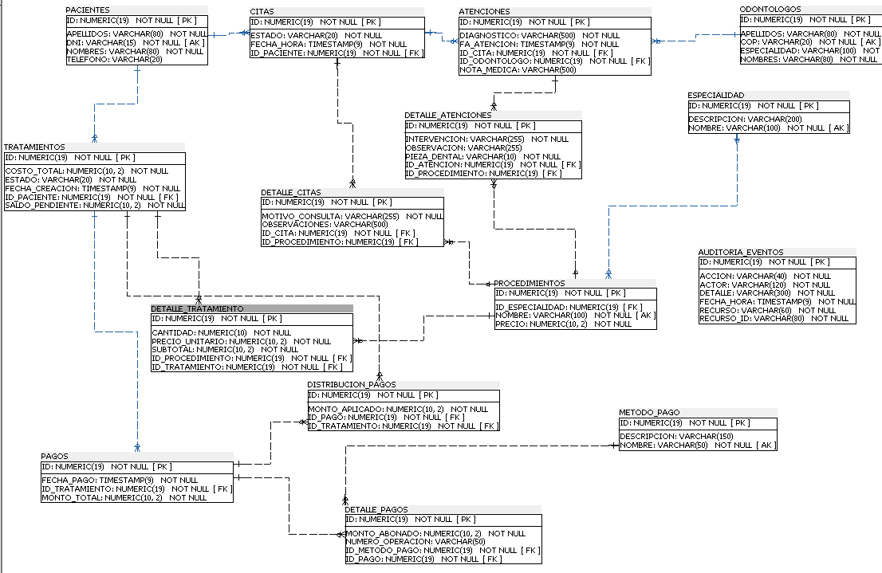

#### Diccionario resumido de las 15 tablas (4 módulos + Auditoría)

| Módulo | Tabla | Clave Primaria | Claves Foráneas / Referencias | Campos y Tipos Oracle |
|---|---|---|---|---|
| 1. Admisión | `PACIENTES` | `ID` (`NUMBER(19)`) | — | `DNI` (`V15 UNIQUE`), `NOMBRES` (`V80`), `APELLIDOS` (`V80`), `TELEFONO` (`V20`) |
| 1. Admisión | `CITAS` | `ID` (`NUMBER(19)`) | `ID_PACIENTE` *(ref. lógica)* | `ESTADO` (`V20`), `FECHA_HORA` (`T`), `ID_PACIENTE` (`N`) |
| 1. Admisión | `DETALLE_CITAS` | `ID` (`NUMBER(19)`) | `ID_CITA` -> `CITAS`, `ID_PROCEDIMIENTO` -> `PROCEDIMIENTOS` | `MOTIVO_CONSULTA` (`V255`), `OBSERVACIONES` (`V500`) |
| 2. Catálogo | `ESPECIALIDAD` | `ID` (`NUMBER(19)`) | — | `NOMBRE` (`V100 UNIQUE`), `DESCRIPCION` (`V200`) |
| 2. Catálogo | `PROCEDIMIENTOS` | `ID` (`NUMBER(19)`) | `ID_ESPECIALIDAD` *(ref. lógica)* | `NOMBRE` (`V100 UNIQUE`), `PRECIO` (`M`) |
| 2. Tratamientos | `TRATAMIENTOS` | `ID` (`NUMBER(19)`) | `ID_PACIENTE` *(ref. lógica)* | `ESTADO` (`V20`), `FECHA_CREACION` (`T`), `COSTO_TOTAL` (`M`), `SALDO_PENDIENTE` (`M`) |
| 2. Tratamientos | `DETALLE_TRATAMIENTO` | `ID` (`NUMBER(19)`) | `ID_TRATAMIENTO` -> `TRATAMIENTOS`, `ID_PROCEDIMIENTO` -> `PROCEDIMIENTOS` | `CANTIDAD` (`NUMBER(10)`), `PRECIO_UNITARIO` (`M`), `SUBTOTAL` (`M`) |
| 3. Atenciones | `ODONTOLOGOS` | `ID` (`NUMBER(19)`) | — | `COP` (`V20 UNIQUE`), `NOMBRES` (`V80`), `APELLIDOS` (`V80`), `ESPECIALIDAD` (`V100`) |
| 3. Atenciones | `ATENCIONES` | `ID` (`NUMBER(19)`) | `ID_CITA`, `ID_ODONTOLOGO` *(refs. lógicas)* | `FA_ATENCION` (`T`), `DIAGNOSTICO` (`V500`), `NOTA_MEDICA` (`V500`) |
| 3. Atenciones | `DETALLE_ATENCIONES` | `ID` (`NUMBER(19)`) | `ID_ATENCION` -> `ATENCIONES`, `ID_PROCEDIMIENTO` -> `PROCEDIMIENTOS` | `PIEZA_DENTAL` (`V10`), `INTERVENCION` (`V255`), `OBSERVACION` (`V255`) |
| 4. Pagos y Caja | `METODO_PAGO` | `ID` (`NUMBER(19)`) | — | `NOMBRE` (`V50 UNIQUE`), `DESCRIPCION` (`V150`) |
| 4. Pagos y Caja | `PAGOS` | `ID` (`NUMBER(19)`) | `ID_TRATAMIENTO` *(ref. lógica)* | `FECHA_PAGO` (`T`), `MONTO_TOTAL` (`M`) |
| 4. Pagos y Caja | `DETALLE_PAGOS` | `ID` (`NUMBER(19)`) | `ID_PAGO` -> `PAGOS`, `ID_METODO_PAGO` -> `METODO_PAGO` | `MONTO_ABONADO` (`M`), `NUMERO_OPERACION` (`V50`) |
| 4. Pagos y Caja | `DISTRIBUCION_PAGOS` | `ID` (`NUMBER(19)`) | `ID_PAGO` -> `PAGOS`, `ID_TRATAMIENTO` -> `TRATAMIENTOS` | `MONTO_APLICADO` (`M`) |
| Transversal | `AUDITORIA_EVENTOS` | `ID` (`NUMBER(19)`) | — | `FECHA_HORA` (`TZ`), `ACTOR` (`V120`), `ACCION` (`V40`), `RECURSO` (`V60`), `RECURSO_ID` (`V80`), `DETALLE` (`V300`) |

*(Leyenda: `N = NUMBER(19)`, `M = NUMBER(10,2)`, `Vn = VARCHAR2(n CHAR)`, `T = TIMESTAMP(9)`, `TZ = TIMESTAMP(9) WITH TIME ZONE`.)*

---

## IV. IMPLEMENTACIÓN DE LA BASE DE DATOS EN ORACLE

### 4.1. Creación de la base de datos
Se utilizó **Oracle AI Database 26ai Free (23.26.3)** corriendo en Docker (`clinicadent-oracle`) dentro de la Pluggable Database **`FREEPDB1`**:
- **`CLINICADENT_APP`**: Esquema en producción conectado en vivo a la aplicación Spring Boot/Angular.
- **`CLINICADENT_BD2`**: Esquema gemelo de pruebas administrativas creado con privilegios `CREATE SESSION`, `CREATE TABLE`, `CREATE VIEW`, `CREATE PROCEDURE`, `CREATE TRIGGER` y `CREATE SEQUENCE` (requerido para columnas `IDENTITY`), reproduciendo las **15 tablas**, **15 claves primarias** y **10 claves foráneas**.

### 4.2. Creación de tablas (DDL completo de los 4 módulos + Auditoría)
Scripts ejecutados en `CLINICADENT_BD2` (`entregable/bd2-scripts/02_bd2_todo_en_uno.sql`), ordenados para respetar dependencias de llaves foráneas:

#### Catálogo Base y Maestros (Módulos 1, 2, 3 y 4)
```sql
CREATE TABLE ESPECIALIDAD (
    ID          NUMBER(19) GENERATED BY DEFAULT AS IDENTITY PRIMARY KEY,
    DESCRIPCION VARCHAR2(200 CHAR),
    NOMBRE      VARCHAR2(100 CHAR) NOT NULL UNIQUE
);

CREATE TABLE PROCEDIMIENTOS (
    ID              NUMBER(19) GENERATED BY DEFAULT AS IDENTITY PRIMARY KEY,
    ID_ESPECIALIDAD NUMBER(19),
    NOMBRE          VARCHAR2(100 CHAR) NOT NULL UNIQUE,
    PRECIO          NUMBER(10,2) NOT NULL
);

CREATE TABLE PACIENTES (
    ID        NUMBER(19) GENERATED BY DEFAULT AS IDENTITY PRIMARY KEY,
    APELLIDOS VARCHAR2(80 CHAR) NOT NULL,
    DNI       VARCHAR2(15 CHAR) NOT NULL UNIQUE,
    NOMBRES   VARCHAR2(80 CHAR) NOT NULL,
    TELEFONO  VARCHAR2(20 CHAR)
);

CREATE TABLE ODONTOLOGOS (
    ID           NUMBER(19) GENERATED BY DEFAULT AS IDENTITY PRIMARY KEY,
    APELLIDOS    VARCHAR2(80 CHAR) NOT NULL,
    COP          VARCHAR2(20 CHAR) NOT NULL UNIQUE,
    ESPECIALIDAD VARCHAR2(100 CHAR) NOT NULL,
    NOMBRES      VARCHAR2(80 CHAR) NOT NULL
);

CREATE TABLE METODO_PAGO (
    ID          NUMBER(19) GENERATED BY DEFAULT AS IDENTITY PRIMARY KEY,
    DESCRIPCION VARCHAR2(150 CHAR),
    NOMBRE      VARCHAR2(50 CHAR) NOT NULL UNIQUE
);
```

#### Cabeceras Transaccionales y Detalles (Módulos 1, 2, 3, 4 y Auditoría)
```sql
-- Módulo 1: Admisión y Citas
CREATE TABLE CITAS (
    ID          NUMBER(19) GENERATED BY DEFAULT AS IDENTITY PRIMARY KEY,
    ESTADO      VARCHAR2(20 CHAR) NOT NULL,
    FECHA_HORA  TIMESTAMP(9) NOT NULL,
    ID_PACIENTE NUMBER(19) NOT NULL
);

CREATE TABLE DETALLE_CITAS (
    ID               NUMBER(19) GENERATED BY DEFAULT AS IDENTITY PRIMARY KEY,
    MOTIVO_CONSULTA  VARCHAR2(255 CHAR) NOT NULL,
    OBSERVACIONES    VARCHAR2(500 CHAR),
    ID_CITA          NUMBER(19) NOT NULL REFERENCES CITAS(ID),
    ID_PROCEDIMIENTO NUMBER(19) REFERENCES PROCEDIMIENTOS(ID)
);

-- Módulo 2: Planes de Tratamiento
CREATE TABLE TRATAMIENTOS (
    ID              NUMBER(19) GENERATED BY DEFAULT AS IDENTITY PRIMARY KEY,
    COSTO_TOTAL     NUMBER(10,2) NOT NULL,
    ESTADO          VARCHAR2(20 CHAR) NOT NULL,
    FECHA_CREACION  TIMESTAMP(9) NOT NULL,
    ID_PACIENTE     NUMBER(19) NOT NULL,
    SALDO_PENDIENTE NUMBER(10,2) NOT NULL
);

CREATE TABLE DETALLE_TRATAMIENTO (
    ID               NUMBER(19) GENERATED BY DEFAULT AS IDENTITY PRIMARY KEY,
    CANTIDAD         NUMBER(10) NOT NULL,
    PRECIO_UNITARIO  NUMBER(10,2) NOT NULL,
    SUBTOTAL         NUMBER(10,2) NOT NULL,
    ID_PROCEDIMIENTO NUMBER(19) NOT NULL REFERENCES PROCEDIMIENTOS(ID),
    ID_TRATAMIENTO   NUMBER(19) NOT NULL REFERENCES TRATAMIENTOS(ID)
);

-- Módulo 3: Atenciones Clínicas
CREATE TABLE ATENCIONES (
    ID            NUMBER(19) GENERATED BY DEFAULT AS IDENTITY PRIMARY KEY,
    DIAGNOSTICO   VARCHAR2(500 CHAR) NOT NULL,
    FA_ATENCION   TIMESTAMP(9) NOT NULL,
    ID_CITA       NUMBER(19) NOT NULL,
    ID_ODONTOLOGO NUMBER(19) NOT NULL,
    NOTA_MEDICA   VARCHAR2(500 CHAR)
);

CREATE TABLE DETALLE_ATENCIONES (
    ID               NUMBER(19) GENERATED BY DEFAULT AS IDENTITY PRIMARY KEY,
    INTERVENCION     VARCHAR2(255 CHAR) NOT NULL,
    OBSERVACION      VARCHAR2(255 CHAR),
    PIEZA_DENTAL     VARCHAR2(10 CHAR) NOT NULL,
    ID_ATENCION      NUMBER(19) NOT NULL REFERENCES ATENCIONES(ID),
    ID_PROCEDIMIENTO NUMBER(19) REFERENCES PROCEDIMIENTOS(ID)
);

-- Módulo 4: Pagos y Caja
CREATE TABLE PAGOS (
    ID             NUMBER(19) GENERATED BY DEFAULT AS IDENTITY PRIMARY KEY,
    FECHA_PAGO     TIMESTAMP(9) NOT NULL,
    ID_TRATAMIENTO NUMBER(19) NOT NULL,
    MONTO_TOTAL    NUMBER(10,2) NOT NULL
);

CREATE TABLE DETALLE_PAGOS (
    ID               NUMBER(19) GENERATED BY DEFAULT AS IDENTITY PRIMARY KEY,
    MONTO_ABONADO    NUMBER(10,2) NOT NULL,
    NUMERO_OPERACION VARCHAR2(50 CHAR),
    ID_METODO_PAGO   NUMBER(19) NOT NULL REFERENCES METODO_PAGO(ID),
    ID_PAGO          NUMBER(19) NOT NULL REFERENCES PAGOS(ID)
);

CREATE TABLE DISTRIBUCION_PAGOS (
    ID             NUMBER(19) GENERATED BY DEFAULT AS IDENTITY PRIMARY KEY,
    MONTO_APLICADO NUMBER(10,2) NOT NULL,
    ID_PAGO        NUMBER(19) NOT NULL REFERENCES PAGOS(ID),
    ID_TRATAMIENTO NUMBER(19) NOT NULL REFERENCES TRATAMIENTOS(ID)
);

-- Transversal: Auditoría
CREATE TABLE AUDITORIA_EVENTOS (
    ID         NUMBER(19) GENERATED BY DEFAULT AS IDENTITY PRIMARY KEY,
    ACCION     VARCHAR2(40 CHAR) NOT NULL,
    ACTOR      VARCHAR2(120 CHAR) NOT NULL,
    DETALLE    VARCHAR2(300 CHAR) NOT NULL,
    FECHA_HORA TIMESTAMP(9) WITH TIME ZONE NOT NULL,
    RECURSO    VARCHAR2(60 CHAR) NOT NULL,
    RECURSO_ID VARCHAR2(80 CHAR) NOT NULL
);
```

### 4.3. Inserción y gestión de información (CRUD SQL)
Se validaron las cuatro operaciones básicas sobre `PACIENTES` (ej. paciente de prueba `BD2-PRUEBA-01` / `BD2-DP-01`):
- `INSERT`: inserción de paciente de prueba con generación automática de `ID`.
- `SELECT`: consulta de verificación por `DNI`.
- `UPDATE`: actualización del teléfono (`900000001` ➔ `900000002`).
- `DELETE` / `ROLLBACK TO`: eliminación controlada confirmando conteo `0`.

### 4.4. Evidencias
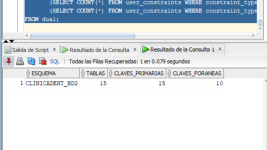
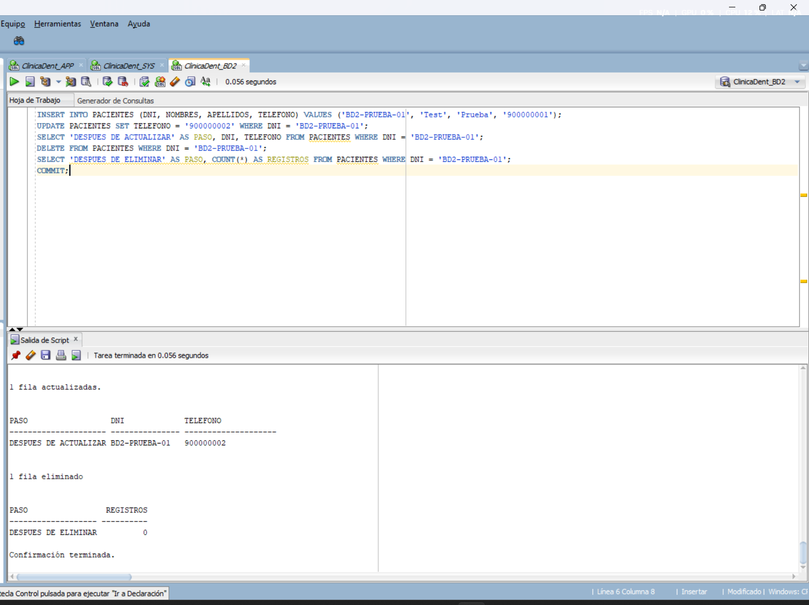

---

## V. DESARROLLO DE PROGRAMACIÓN PL/SQL

Se implementaron objetos PL/SQL integrando admisión, citas, pacientes y auditoría dentro de `CLINICADENT_BD2`:

### 5.1. Bloques PL/SQL
Bloque anónimo con `SET SERVEROUTPUT ON` que obtiene el paciente de prueba, consulta el conteo previo de citas, ejecuta `REGISTRAR_CITA_BD2`, verifica el conteo posterior y consulta el estado asignado:

```sql
SET SERVEROUTPUT ON;
DECLARE
    v_id_paciente NUMBER;
    v_id_cita     NUMBER;
    v_estado      VARCHAR2(20);
    v_antes       NUMBER;
    v_despues     NUMBER;
BEGIN
    SELECT ID INTO v_id_paciente FROM PACIENTES WHERE DNI = 'BD2-DP-01';
    v_antes := CONTAR_CITAS_BD2(v_id_paciente);
    REGISTRAR_CITA_BD2(v_id_paciente, LOCALTIMESTAMP + INTERVAL '1' DAY, v_id_cita);
    v_despues := CONTAR_CITAS_BD2(v_id_paciente);
    SELECT ESTADO INTO v_estado FROM CITAS WHERE ID = v_id_cita;

    DBMS_OUTPUT.PUT_LINE('Cita ' || v_id_cita || ' - Estado: ' || v_estado);
    DBMS_OUTPUT.PUT_LINE('Citas antes: ' || v_antes || ' | Citas despues: ' || v_despues);
    COMMIT;
END;
/
```

### 5.2. Procedimientos almacenados
`REGISTRAR_CITA_BD2` valida la existencia del paciente y registra una cita en estado `PROGRAMADA`, devolviendo el `ID` generado por parámetro `OUT` y manejando la excepción `NO_DATA_FOUND`:

```sql
CREATE OR REPLACE PROCEDURE REGISTRAR_CITA_BD2 (
    p_id_paciente IN NUMBER,
    p_fecha_hora  IN TIMESTAMP,
    p_id_cita     OUT NUMBER
) AS
    v_id_paciente NUMBER;
BEGIN
    SELECT ID INTO v_id_paciente FROM PACIENTES WHERE ID = p_id_paciente;

    INSERT INTO CITAS (ID_PACIENTE, FECHA_HORA, ESTADO)
    VALUES (v_id_paciente, p_fecha_hora, 'PROGRAMADA')
    RETURNING ID INTO p_id_cita;
EXCEPTION
    WHEN NO_DATA_FOUND THEN
        RAISE_APPLICATION_ERROR(-20001, 'El paciente indicado no existe');
END;
/
```

### 5.3. Funciones
`CONTAR_CITAS_BD2` recibe el `ID` del paciente y devuelve la cantidad total de citas registradas:

```sql
CREATE OR REPLACE FUNCTION CONTAR_CITAS_BD2 (
    p_id_paciente IN NUMBER
) RETURN NUMBER AS
    v_total NUMBER;
BEGIN
    SELECT COUNT(*) INTO v_total FROM CITAS WHERE ID_PACIENTE = p_id_paciente;
    RETURN v_total;
END;
/
```

### 5.4. Cursores y estructuras de control
Cursor explícito `c_citas_bd2` que une `CITAS` con `PACIENTES`, recorre fila por fila mediante `OPEN / FETCH / CLOSE` con condición de salida `%NOTFOUND` e imprime el detalle en consola:

```sql
DECLARE
    CURSOR c_citas_bd2 IS
        SELECT c.ID, p.NOMBRES || ' ' || p.APELLIDOS AS PACIENTE, c.ESTADO
        FROM CITAS c
        INNER JOIN PACIENTES p ON p.ID = c.ID_PACIENTE
        ORDER BY c.ID;
    v_reg c_citas_bd2%ROWTYPE;
BEGIN
    OPEN c_citas_bd2;
    LOOP
        FETCH c_citas_bd2 INTO v_reg;
        EXIT WHEN c_citas_bd2%NOTFOUND;
        DBMS_OUTPUT.PUT_LINE('Cursor -> Cita #' || v_reg.ID || ' | Paciente: ' || v_reg.PACIENTE || ' | Estado: ' || v_reg.ESTADO);
    END LOOP;
    CLOSE c_citas_bd2;
END;
/
```

### 5.5. Triggers
`TRG_AUDITAR_CITA_BD2` es un disparador `AFTER INSERT ON CITAS FOR EACH ROW` que registra automáticamente en `AUDITORIA_EVENTOS` al usuario de sesión (`SYS_CONTEXT('USERENV', 'SESSION_USER')`), el estado `:NEW.ESTADO` y el ID `:NEW.ID`:

```sql
CREATE OR REPLACE TRIGGER TRG_AUDITAR_CITA_BD2
AFTER INSERT ON CITAS
FOR EACH ROW
BEGIN
    INSERT INTO AUDITORIA_EVENTOS (
        ACCION, ACTOR, DETALLE, FECHA_HORA, RECURSO, RECURSO_ID
    ) VALUES (
        'CREAR',
        SYS_CONTEXT('USERENV', 'SESSION_USER'),
        'Cita registrada con estado ' || :NEW.ESTADO,
        SYSTIMESTAMP,
        'CITA',
        TO_CHAR(:NEW.ID)
    );
END;
/
```

> **Evidencia obligatoria:**  
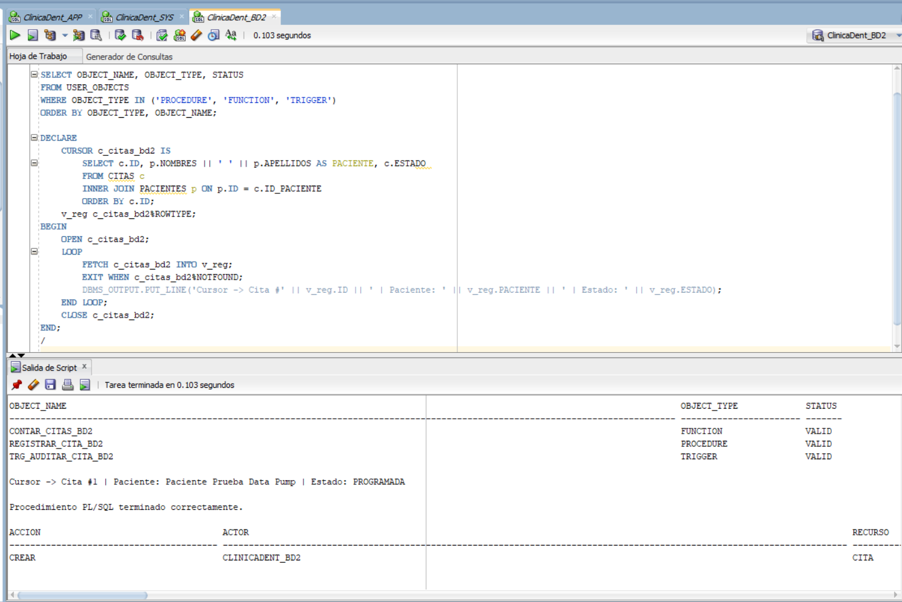

---

## VI. ADMINISTRACIÓN DE TABLESPACES Y DATAFILES

### 6.1. Creación de TABLESPACES
Conectados como `SYS` (`SYSDBA`) en `FREEPDB1`, se creó el tablespace **`TS_CLINICADENT_BD2`** para aislar el crecimiento de la tabla histórica particionada `TRATAMIENTOS_HIST_BD2`.

### 6.2. Administración de DATAFILES
El datafile físico asociado fue **`/opt/oracle/oradata/FREE/FREEPDB1/clinicadent_bd2_01.dbf`**, configurado con `20M` iniciales, extensión automática de `5M` (`AUTOEXTEND ON NEXT 5M`) y tamaño máximo de `100M`.

### 6.3. Asignación de almacenamiento
Se asignó al usuario `CLINICADENT_BD2` una cuota de `50M` sobre `TS_CLINICADENT_BD2` (donde residen las 3 particiones de `TRATAMIENTOS_HIST_BD2`), manteniendo el tablespace `USERS` para las 15 tablas operacionales.

### 6.4. Evidencias
```sql
CREATE TABLESPACE TS_CLINICADENT_BD2
    DATAFILE '/opt/oracle/oradata/FREE/FREEPDB1/clinicadent_bd2_01.dbf'
    SIZE 20M
    AUTOEXTEND ON NEXT 5M MAXSIZE 100M;

ALTER USER CLINICADENT_BD2 QUOTA 50M ON TS_CLINICADENT_BD2;

SELECT TABLESPACE_NAME, FILE_NAME, ROUND(BYTES / 1024 / 1024, 2) AS TAMANO_MB, AUTOEXTENSIBLE
FROM DBA_DATA_FILES
WHERE TABLESPACE_NAME = 'TS_CLINICADENT_BD2';
```

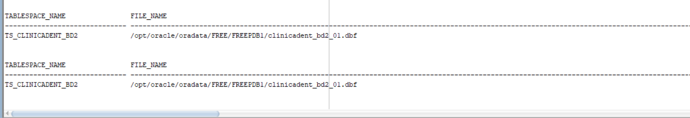
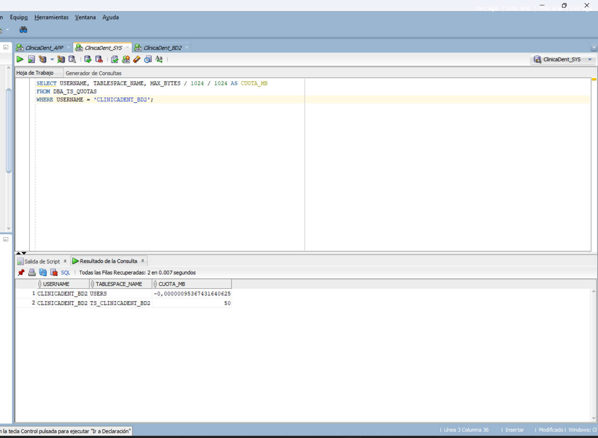

### Monitoreo y diagnóstico operativo (Sesiones, Bloqueos y Rendimiento)
- **Bloqueos de fila (`V$SESSION`):** Se simuló una transacción sin confirmar (`UPDATE` en sesión `52`) mientras una segunda sesión (`57`) intentaba modificar la misma fila, observando espera `enq: TX - row lock contention` (`Transaction` en `DBA_WAITERS`/`DBA_BLOCKERS`) y su liberación inmediata tras ejecutar `ROLLBACK` en la sesión `52`.
- **Integridad y caché:** `DBA_OBJECTS` reportó `0` objetos inválidos en `CLINICADENT_BD2` y `V$SYSSTAT` registró un ratio de acierto de caché de `99,16 %`.
- **Plan de consulta:** La búsqueda en `PACIENTES.DNI` utilizó `INDEX UNIQUE SCAN` + `TABLE ACCESS BY INDEX ROWID`.

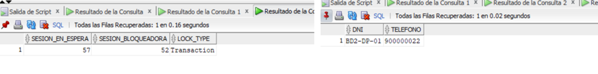
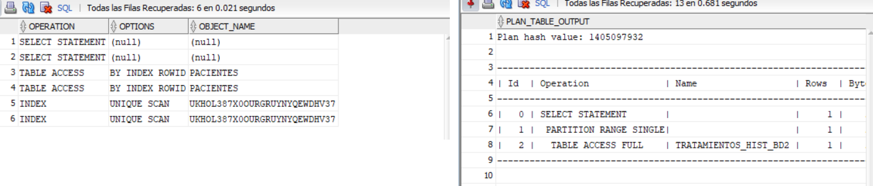

---

## VII. PARTICIONAMIENTO DE TABLAS

### 7.1. Descripción del particionamiento
Se seleccionó **`TRATAMIENTOS_HIST_BD2`** (estructura espejo histórica de `TRATAMIENTOS` del Módulo 2) para evitar escaneos completos en consultas históricas por fecha sin alterar la tabla activa transaccional.

### 7.2. Tipo de particionamiento utilizado
- **Tipo implementado:** **`RANGE`** sobre la columna `FECHA_CREACION` (`TIMESTAMP`).
- Particiones anuales definidas sobre `TS_CLINICADENT_BD2`: `P_HASTA_2026`, `P_2027` y `P_DESDE_2028` (`MAXVALUE`).

### 7.3. Implementación
```sql
CREATE TABLE TRATAMIENTOS_HIST_BD2 (
    ID              NUMBER(19) GENERATED BY DEFAULT AS IDENTITY PRIMARY KEY,
    COSTO_TOTAL     NUMBER(10,2) NOT NULL,
    ESTADO          VARCHAR2(20 CHAR) NOT NULL,
    FECHA_CREACION  TIMESTAMP(9) NOT NULL,
    ID_PACIENTE     NUMBER(19) NOT NULL,
    SALDO_PENDIENTE NUMBER(10,2) NOT NULL
)
PARTITION BY RANGE (FECHA_CREACION) (
    PARTITION P_HASTA_2026 VALUES LESS THAN (TIMESTAMP '2027-01-01 00:00:00') TABLESPACE TS_CLINICADENT_BD2,
    PARTITION P_2027       VALUES LESS THAN (TIMESTAMP '2028-01-01 00:00:00') TABLESPACE TS_CLINICADENT_BD2,
    PARTITION P_DESDE_2028 VALUES LESS THAN (MAXVALUE)                         TABLESPACE TS_CLINICADENT_BD2
);
```

### 7.4. Resultados
Insertando fechas de prueba (`2026-12-31`, `2027-01-01` y `2028-01-01`) y consultando `USER_TAB_PARTITIONS` y `EXPLAIN PLAN` para el intervalo 2027, Oracle mostró **`PARTITION RANGE SINGLE`**, confirmando que solo accede a la partición `P_2027` (*Partition Pruning*).

> **Evidencia obligatoria:**  
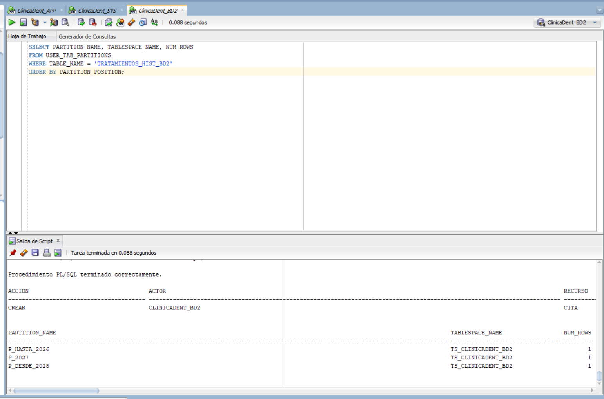
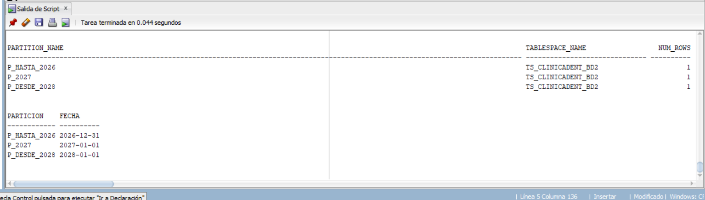

---

## VIII. EXPORTACIÓN E IMPORTACIÓN DE INFORMACIÓN

### 8.1. Exportación de información (`EXPDP`)
Se creó el directorio Oracle **`BD2_DATAPUMP`** apuntando a `/opt/oracle/oradata/bd2_datapump` con permisos `READ, WRITE` para `CLINICADENT_BD2`, y se ejecutó la exportación lógica del esquema completo:

```sql
CREATE OR REPLACE DIRECTORY BD2_DATAPUMP AS '/opt/oracle/oradata/bd2_datapump';
GRANT READ, WRITE ON DIRECTORY BD2_DATAPUMP TO CLINICADENT_BD2;
```

```powershell
docker exec clinicadent-oracle expdp CLINICADENT_BD2/123456@localhost:1521/FREEPDB1 DIRECTORY=BD2_DATAPUMP DUMPFILE=clinicadent_bd2.dmp LOGFILE=clinicadent_bd2_exp.log SCHEMAS=CLINICADENT_BD2
```

### 8.2. Importación de información (`IMPDP`)
Se recuperó la tabla `PACIENTES` desde el respaldo como **`PACIENTES_RECUP_BD2`** utilizando `REMAP_TABLE` (y se realizó una simulación adicional de pérdida temporal renombrando la tabla y verificando conteo `0` antes de restaurarla):

```powershell
docker exec clinicadent-oracle impdp CLINICADENT_BD2/123456@localhost:1521/FREEPDB1 DIRECTORY=BD2_DATAPUMP DUMPFILE=clinicadent_bd2.dmp LOGFILE=clinicadent_bd2_imp.log TABLES=CLINICADENT_BD2.PACIENTES REMAP_TABLE=CLINICADENT_BD2.PACIENTES:PACIENTES_RECUP_BD2 EXCLUDE=INDEX,CONSTRAINT,STATISTICS
```

### 8.3. Archivos generados

| Archivo | Ubicación y Propósito |
|---|---|
| `clinicadent_bd2.dmp` | `/opt/oracle/oradata/bd2_datapump/` — Volcado binario lógico del esquema `CLINICADENT_BD2`. |
| `clinicadent_bd2_exp.log` | `/opt/oracle/oradata/bd2_datapump/` — Bitácora de exportación `EXPDP`. |
| `clinicadent_bd2_imp.log` | `/opt/oracle/oradata/bd2_datapump/` — Bitácora de importación `IMPDP`. |

### 8.4. Verificación de resultados
```sql
SELECT 'ORIGINAL' AS ORIGEN, ID, DNI, NOMBRES, APELLIDOS FROM PACIENTES WHERE DNI = 'BD2-DP-01'
UNION ALL
SELECT 'IMPORTADO' AS ORIGEN, ID, DNI, NOMBRES, APELLIDOS FROM PACIENTES_RECUP_BD2 WHERE DNI = 'BD2-DP-01';
```

> **Evidencia obligatoria:**  
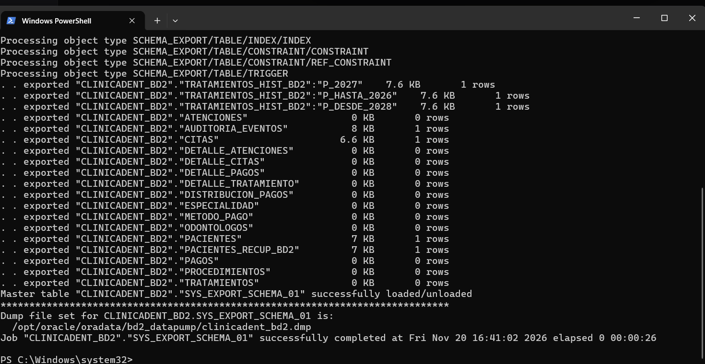
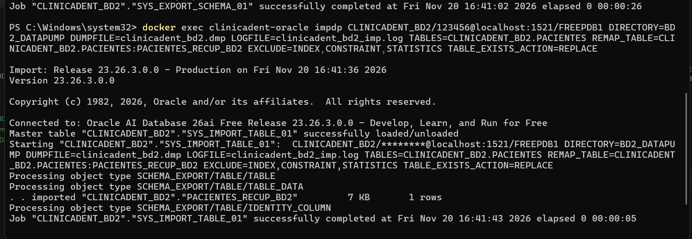
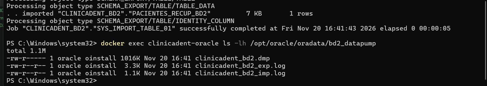
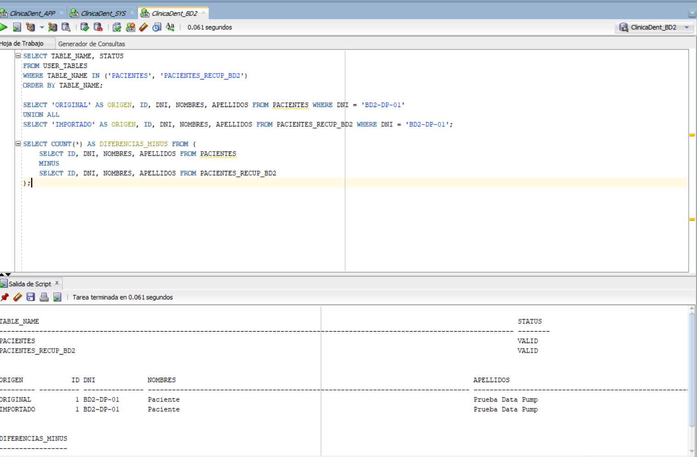

### Evidencia adicional: Respaldo físico y validación con RMAN
Como práctica complementaria de resiliencia, dado que la instancia `FREE` opera en `NOARCHIVELOG`, se realizó un cierre consistente (`SHUTDOWN IMMEDIATE`), montaje (`STARTUP MOUNT`) y respaldo físico completo con etiqueta **`BD2_FRIO`**, validando los 5 backup sets generados (`VALIDATE BACKUPSET 1..5`) y comprobando la reapertura de `FREEPDB1` en modo `READ WRITE`.

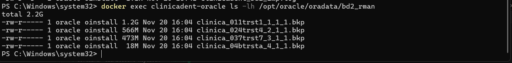
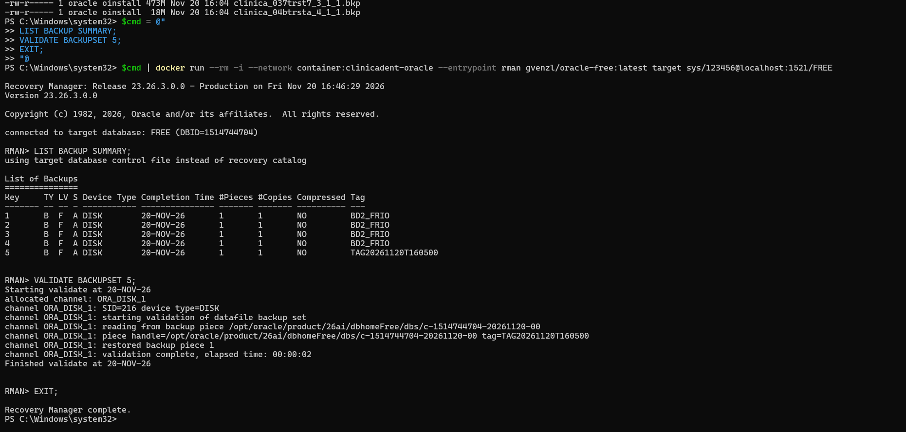

---

## IX. CONCLUSIONES

- **Modelo relacional:** Las 15 tablas base (15 PKs, 10 FKs declaradas y 6 referencias lógicas entre módulos) representan integralmente los procesos de Admisión, Tratamientos, Atenciones, Pagos y Auditoría de Clínica Dent.
- **Programación PL/SQL:** `REGISTRAR_CITA_BD2`, `CONTAR_CITAS_BD2`, el cursor `c_citas_bd2` y el trigger `TRG_AUDITAR_CITA_BD2` permiten validar reglas y auditar operaciones directamente dentro de Oracle.
- **Tablespaces y Datafiles:** `TS_CLINICADENT_BD2` con crecimiento automático (`AUTOEXTEND`) aísla el almacenamiento del histórico respecto al tablespace operativo `USERS`.
- **Particionamiento:** La tabla `TRATAMIENTOS_HIST_BD2` particionada por `RANGE` demostró *Partition Pruning* (`PARTITION RANGE SINGLE`), evitando lecturas innecesarias de años anteriores.
- **Exportación e importación:** Data Pump (`EXPDP`/`IMPDP`) permitió respaldar el esquema completo y recuperar tablas tras una pérdida simulada de disponibilidad, complementado con respaldo físico validado en RMAN.
- **Aporte del sistema:** La separación entre el esquema vivo (`CLINICADENT_APP`) y el esquema de pruebas DBA (`CLINICADENT_BD2`) dentro de `FREEPDB1` permite administrar, auditar y probar la resiliencia del sistema sin afectar la operación en vivo.

---

## X. RECOMENDACIONES

- Almacenar los archivos `.dmp`, logs de Data Pump y copias físicas RMAN fuera del disco local del contenedor Docker.
- Habilitar el modo `ARCHIVELOG` en entornos de producción para permitir respaldos físicos en caliente y recuperación a un punto en el tiempo (*PITR*).
- Mantener la separación de privilegios entre el propietario del esquema y el usuario técnico de la aplicación.
- Actualizar estadísticas periódicamente con `DBMS_STATS.GATHER_SCHEMA_STATS` conforme aumente el volumen de citas, atenciones y pagos.

---

## XI. REFERENCIAS BIBLIOGRÁFICAS

- Oracle Corporation. *Oracle AI Database PL/SQL Language Reference, 26ai*.
- Oracle Corporation. *Oracle AI Database Administrator's Guide — Managing Tablespaces*.
- Oracle Corporation. *Oracle Database VLDB and Partitioning Guide*.
- Oracle Corporation. *Oracle AI Database Utilities — Oracle Data Pump (EXPDP / IMPDP)*.
- Oracle Corporation. *Oracle Database Backup and Recovery User's Guide (RMAN)*.
