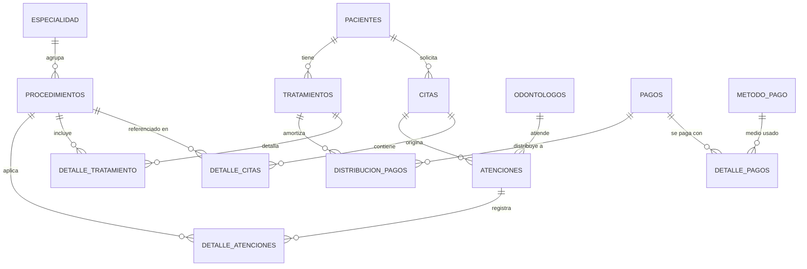

# INFORME FINAL DEL PROYECTO DE BASE DE DATOS II

**Implementación y administración de base de datos utilizando Oracle Database**

---

## PORTADA

- **Institución:** Universidad Peruana Unión (UPeU) — Filial Juliaca
- **Programa de Estudios / Carrera Profesional:** Ingeniería de Sistemas
- **Asignatura:** Administración de Base de Datos II
- **Título del Proyecto:** Implementación y Administración de la Base de Datos Oracle para el Sistema de Gestión Odontológica **ClinicaDent**
- **Integrantes del Equipo:**
  - Axcel Vargas
  - Erick Midwar
  - Paul Cariapaza
  - Eddy Brayan
- **Docente Responsable:** Eder Quispe
- **Ciclo / Semestre Académico:** IV Ciclo — 2026-II
- **Lugar y Fecha:** Juliaca, noviembre de 2026

---

## I. RESUMEN EJECUTIVO

El presente informe detalla el diseño, implementación, programación y administración de la base de datos empresarial en **Oracle Database** para el sistema de gestión odontológica **ClinicaDent**.

El proyecto responde a la necesidad de centralizar y controlar de forma íntegra las operaciones de una clínica dental: registro de pacientes, programación de citas, catálogo de especialidades y procedimientos, planes de tratamiento con saldos pendientes, atenciones clínicas por odontólogo, pagos multipago/multitratamiento en caja y trazabilidad mediante auditoría de eventos.

Para la persistencia y administración se utilizó **Oracle Database (arquitectura Multitenant PDB `FREEPDB1`)** integrado con un backend modular en **Spring Boot (Java 21)** y un frontend en **Angular**, asegurando control transaccional, seguridad por roles con **Keycloak** y gestión administrativa de almacenamiento (`TABLESPACES` y `DATAFILES`), programación avanzada **PL/SQL** (bloques, procedimientos, funciones, cursores y triggers), **particionamiento por rango (`RANGE`)** y procesos de respaldo lógico mediante **Oracle Data Pump (`EXPDP`/`IMPDP`)** y utilidades **`exp`/`imp`**.

---

## II. PLANTEAMIENTO DEL PROYECTO

### 2.1. Descripción del problema
En una clínica odontológica, la gestión manual o desconectada de citas, planes de tratamiento, atenciones clínicas y cobros genera problemas críticos: pérdida de historial clínico por pieza dental, descontrol en las cuentas por cobrar cuando un paciente realiza abonos parciales con distintos medios de pago, ausencia de trazabilidad sobre quién realizó operaciones sensibles y falta de políticas de respaldo y almacenamiento organizado en base de datos.

### 2.2. Justificación
Implementar una base de datos relacional administrada sobre **Oracle Database** permite garantizar la integridad referencial entre pacientes, citas, tratamientos y pagos; automatizar validaciones y cálculos financieros mediante **PL/SQL** directamente en el motor; optimizar el acceso histórico mediante **particionamiento** y **tablespaces dedicados**; y asegurar la continuidad operativa del negocio mediante **exportaciones e importaciones verificables (`EXPDP`/`IMPDP`)**.

### 2.3. Objetivos

**Objetivo general:**
Desarrollar e implementar un sistema de información con base de datos Oracle administrada que permita gestionar y controlar eficientemente los procesos clínicos y financieros de la clínica odontológica **ClinicaDent**.

**Objetivos específicos:**
- Diseñar el modelo relacional de la base de datos abarcando admisión, catálogo/tratamientos, atenciones clínicas, pagos y auditoría.
- Implementar la base de datos en Oracle Database dentro de la Pluggable Database (`FREEPDB1`).
- Desarrollar bloques anónimos, procedimientos almacenados, funciones, cursores y triggers mediante PL/SQL.
- Implementar estructuras de almacenamiento lógico y físico mediante `TABLESPACES` y `DATAFILES`.
- Aplicar particionamiento por rango (`RANGE`) sobre la tabla histórica de pagos (`PAGOS_HISTORICO`).
- Realizar procesos de exportación e importación lógica mediante Data Pump (`EXPDP` / `IMPDP`) y `exp` / `imp`.

### 2.4. Alcance del sistema
El sistema abarca cuatro módulos de negocio y un módulo transversal de auditoría:
1. **Módulo 1 — Citas y Admisión:** Gestión de pacientes (`PACIENTES`) y programación de citas con sus procedimientos solicitados (`CITAS`, `DETALLE_CITAS`).
2. **Módulo 2 — Catálogo y Tratamientos:** Especialidades (`ESPECIALIDAD`), procedimientos con tarifas (`PROCEDIMIENTOS`) y planes de tratamiento con control de costo total y saldo pendiente (`TRATAMIENTOS`, `DETALLE_TRATAMIENTO`).
3. **Módulo 3 — Atenciones Clínicas:** Registro de odontólogos (`ODONTOLOGOS`) y atenciones realizadas por pieza dental (`ATENCIONES`, `DETALLE_ATENCIONES`).
4. **Módulo 4 — Pagos y Caja:** Catálogo de medios de pago (`METODO_PAGO`), recibos de pago (`PAGOS`), desglose multipago (`DETALLE_PAGOS`) y distribución de abonos entre múltiples tratamientos (`DISTRIBUCION_PAGOS`).
5. **Auditoría Transversal:** Registro histórico de eventos críticos (`AUDITORIA_EVENTOS`).

---

## III. ANÁLISIS Y DISEÑO DEL SISTEMA DE INFORMACIÓN

### 3.1. Descripción del sistema
El sistema opera bajo control de acceso basado en roles (`ADMINISTRADOR`, `RECEPCIONISTA`, `ODONTOLOGO`, `CAJERO`):
- La **Recepcionista** registra pacientes y programa citas.
- El **Odontólogo** registra atenciones clínicas (diagnóstico, pieza dental e intervención) y arma planes de tratamiento cuyo costo total se calcula a partir de los procedimientos.
- El **Cajero** registra abonos en `PAGOS` combinando varios medios (`DETALLE_PAGOS`) y repartiéndolos entre uno o varios planes de tratamiento (`DISTRIBUCION_PAGOS`), descontando el `SALDO_PENDIENTE` de manera atómica.
- El **Administrador** supervisa la auditoría, reportes y administración de la base de datos Oracle.

### 3.2. Modelo relacional

La base de datos está conformada por **15 tablas principales** dentro del esquema `CLINICADENT_APP`:

| Módulo | Tabla | Clave Primaria (PK) | Claves Foráneas / Referencias | Campos y Restricciones Clave |
|---|---|---|---|---|
| Admisión | `PACIENTES` | `ID` | — | `DNI` (`UNIQUE`, `NOT NULL`), `NOMBRES`, `APELLIDOS`, `TELEFONO` |
| Admisión | `CITAS` | `ID` | `ID_PACIENTE` | `FECHA_HORA` (`NOT NULL`), `ESTADO` (`PROGRAMADA`/`ATENDIDA`/`CANCELADA`) |
| Admisión | `DETALLE_CITAS` | `ID` | `ID_CITA` -> `CITAS`, `ID_PROCEDIMIENTO` -> `PROCEDIMIENTOS` | `MOTIVO_CONSULTA` (`NOT NULL`), `OBSERVACIONES` |
| Catálogo | `ESPECIALIDAD` | `ID` | — | `NOMBRE` (`UNIQUE`, `NOT NULL`), `DESCRIPCION` |
| Catálogo | `PROCEDIMIENTOS` | `ID` | `ID_ESPECIALIDAD` | `NOMBRE` (`UNIQUE`, `NOT NULL`), `PRECIO` (`NUMBER(10,2)`) |
| Tratamientos | `TRATAMIENTOS` | `ID` | `ID_PACIENTE` | `FECHA_CREACION`, `ESTADO`, `COSTO_TOTAL`, `SALDO_PENDIENTE` |
| Tratamientos | `DETALLE_TRATAMIENTO` | `ID` | `ID_TRATAMIENTO` -> `TRATAMIENTOS`, `ID_PROCEDIMIENTO` -> `PROCEDIMIENTOS` | `PRECIO_UNITARIO`, `CANTIDAD`, `SUBTOTAL` |
| Atenciones | `ODONTOLOGOS` | `ID` | — | `COP` (`UNIQUE`, `NOT NULL`), `NOMBRES`, `APELLIDOS`, `ESPECIALIDAD` |
| Atenciones | `ATENCIONES` | `ID` | `ID_CITA`, `ID_ODONTOLOGO` | `FA_ATENCION`, `DIAGNOSTICO` (`NOT NULL`), `NOTA_MEDICA` |
| Atenciones | `DETALLE_ATENCIONES` | `ID` | `ID_ATENCION` -> `ATENCIONES`, `ID_PROCEDIMIENTO` -> `PROCEDIMIENTOS` | `PIEZA_DENTAL`, `INTERVENCION`, `OBSERVACION` |
| Pagos y Caja | `METODO_PAGO` | `ID` | — | `NOMBRE` (`UNIQUE`, `NOT NULL`), `DESCRIPCION` |
| Pagos y Caja | `PAGOS` | `ID` | `ID_TRATAMIENTO` | `FECHA_PAGO` (`NOT NULL`), `MONTO_TOTAL` (`NUMBER(10,2)`) |
| Pagos y Caja | `DETALLE_PAGOS` | `ID` | `ID_PAGO` -> `PAGOS`, `ID_METODO_PAGO` -> `METODO_PAGO` | `MONTO_ABONADO` (`NUMBER(10,2)`), `NUMERO_OPERACION` |
| Pagos y Caja | `DISTRIBUCION_PAGOS` | `ID` | `ID_PAGO` -> `PAGOS`, `ID_TRATAMIENTO` -> `TRATAMIENTOS` | `MONTO_APLICADO` (`NUMBER(10,2)`) |
| Auditoría | `AUDITORIA_EVENTOS` | `ID` | — | `FECHA_HORA`, `ACTOR`, `ACCION`, `RECURSO`, `RECURSO_ID`, `DETALLE` |

#### Diagrama del Modelo Relacional (Entidad-Relación)



> **Evidencia obligatoria:** `[PEGAR AQUÍ CAPTURA DEL MODELO RELACIONAL GENERADO EN SQL DEVELOPER (Data Modeler)]`

---

## IV. IMPLEMENTACIÓN DE LA BASE DE DATOS EN ORACLE

### 4.1. Creación de la base de datos
Se empleó **Oracle Database (arquitectura Multitenant CDB/PDB)** operando sobre la Pluggable Database **`FREEPDB1`** en contenedor Docker (`clinicadent-oracle`, puerto mapeado `1523:1521`) administrado desde **Oracle SQL Developer**:
- Conexión administrativa: `SYS` con rol `SYSDBA` sobre `localhost:1523/FREEPDB1`.
- Esquema de aplicación: `CLINICADENT_APP` sobre `localhost:1523/FREEPDB1`.

### 4.2. Creación de tablas
Scripts SQL completos de las **15 tablas del sistema** (abarcando los 4 módulos del equipo y auditoría) dentro del esquema `CLINICADENT_APP`, con llaves primarias `IDENTITY`, restricciones `NOT NULL`, `UNIQUE` y llaves foráneas `FOREIGN KEY`:

#### Módulo 1: Admisión y Citas (`PACIENTES`, `CITAS`, `DETALLE_CITAS`)
```sql
CREATE TABLE PACIENTES (
    ID        NUMBER GENERATED BY DEFAULT AS IDENTITY PRIMARY KEY,
    DNI       VARCHAR2(15) NOT NULL UNIQUE,
    NOMBRES   VARCHAR2(80) NOT NULL,
    APELLIDOS VARCHAR2(80) NOT NULL,
    TELEFONO  VARCHAR2(20)
);

CREATE TABLE CITAS (
    ID          NUMBER GENERATED BY DEFAULT AS IDENTITY PRIMARY KEY,
    ID_PACIENTE NUMBER NOT NULL,
    FECHA_HORA  TIMESTAMP NOT NULL,
    ESTADO      VARCHAR2(20) NOT NULL
);

CREATE TABLE DETALLE_CITAS (
    ID               NUMBER GENERATED BY DEFAULT AS IDENTITY PRIMARY KEY,
    ID_CITA          NUMBER NOT NULL REFERENCES CITAS(ID),
    ID_PROCEDIMIENTO NUMBER REFERENCES PROCEDIMIENTOS(ID),
    MOTIVO_CONSULTA  VARCHAR2(255) NOT NULL,
    OBSERVACIONES    VARCHAR2(500)
);
```

#### Módulo 2: Catálogo y Planes de Tratamiento (`ESPECIALIDAD`, `PROCEDIMIENTOS`, `TRATAMIENTOS`, `DETALLE_TRATAMIENTO`)
```sql
CREATE TABLE ESPECIALIDAD (
    ID          NUMBER GENERATED BY DEFAULT AS IDENTITY PRIMARY KEY,
    NOMBRE      VARCHAR2(100) NOT NULL UNIQUE,
    DESCRIPCION VARCHAR2(200)
);

CREATE TABLE PROCEDIMIENTOS (
    ID              NUMBER GENERATED BY DEFAULT AS IDENTITY PRIMARY KEY,
    ID_ESPECIALIDAD NUMBER,
    NOMBRE          VARCHAR2(100) NOT NULL UNIQUE,
    PRECIO          NUMBER(10,2) NOT NULL
);

CREATE TABLE TRATAMIENTOS (
    ID              NUMBER GENERATED BY DEFAULT AS IDENTITY PRIMARY KEY,
    ID_PACIENTE     NUMBER NOT NULL,
    FECHA_CREACION  TIMESTAMP NOT NULL,
    ESTADO          VARCHAR2(20) NOT NULL,
    COSTO_TOTAL     NUMBER(10,2) NOT NULL,
    SALDO_PENDIENTE NUMBER(10,2) NOT NULL
);

CREATE TABLE DETALLE_TRATAMIENTO (
    ID               NUMBER GENERATED BY DEFAULT AS IDENTITY PRIMARY KEY,
    ID_TRATAMIENTO   NUMBER NOT NULL REFERENCES TRATAMIENTOS(ID),
    ID_PROCEDIMIENTO NUMBER NOT NULL REFERENCES PROCEDIMIENTOS(ID),
    PRECIO_UNITARIO  NUMBER(10,2) NOT NULL,
    CANTIDAD         NUMBER NOT NULL,
    SUBTOTAL         NUMBER(10,2) NOT NULL
);
```

#### Módulo 3: Atenciones Clínicas (`ODONTOLOGOS`, `ATENCIONES`, `DETALLE_ATENCIONES`)
```sql
CREATE TABLE ODONTOLOGOS (
    ID           NUMBER GENERATED BY DEFAULT AS IDENTITY PRIMARY KEY,
    COP          VARCHAR2(20) NOT NULL UNIQUE,
    NOMBRES      VARCHAR2(80) NOT NULL,
    APELLIDOS    VARCHAR2(80) NOT NULL,
    ESPECIALIDAD VARCHAR2(100) NOT NULL
);

CREATE TABLE ATENCIONES (
    ID            NUMBER GENERATED BY DEFAULT AS IDENTITY PRIMARY KEY,
    ID_CITA       NUMBER NOT NULL,
    ID_ODONTOLOGO NUMBER NOT NULL,
    FA_ATENCION   TIMESTAMP NOT NULL,
    DIAGNOSTICO   VARCHAR2(500) NOT NULL,
    NOTA_MEDICA   VARCHAR2(500)
);

CREATE TABLE DETALLE_ATENCIONES (
    ID               NUMBER GENERATED BY DEFAULT AS IDENTITY PRIMARY KEY,
    ID_ATENCION      NUMBER NOT NULL REFERENCES ATENCIONES(ID),
    ID_PROCEDIMIENTO NUMBER REFERENCES PROCEDIMIENTOS(ID),
    PIEZA_DENTAL     VARCHAR2(10) NOT NULL,
    INTERVENCION     VARCHAR2(255) NOT NULL,
    OBSERVACION      VARCHAR2(255)
);
```

#### Módulo 4: Pagos y Caja (`METODO_PAGO`, `PAGOS`, `DETALLE_PAGOS`, `DISTRIBUCION_PAGOS`)
```sql
CREATE TABLE METODO_PAGO (
    ID          NUMBER GENERATED BY DEFAULT AS IDENTITY PRIMARY KEY,
    NOMBRE      VARCHAR2(50) NOT NULL UNIQUE,
    DESCRIPCION VARCHAR2(150)
);

CREATE TABLE PAGOS (
    ID             NUMBER GENERATED BY DEFAULT AS IDENTITY PRIMARY KEY,
    ID_TRATAMIENTO NUMBER NOT NULL,
    FECHA_PAGO     TIMESTAMP NOT NULL,
    MONTO_TOTAL    NUMBER(10,2) NOT NULL
);

CREATE TABLE DETALLE_PAGOS (
    ID               NUMBER GENERATED BY DEFAULT AS IDENTITY PRIMARY KEY,
    ID_PAGO          NUMBER NOT NULL REFERENCES PAGOS(ID),
    ID_METODO_PAGO   NUMBER NOT NULL REFERENCES METODO_PAGO(ID),
    MONTO_ABONADO    NUMBER(10,2) NOT NULL,
    NUMERO_OPERACION VARCHAR2(50)
);

CREATE TABLE DISTRIBUCION_PAGOS (
    ID             NUMBER GENERATED BY DEFAULT AS IDENTITY PRIMARY KEY,
    ID_PAGO        NUMBER NOT NULL REFERENCES PAGOS(ID),
    ID_TRATAMIENTO NUMBER NOT NULL REFERENCES TRATAMIENTOS(ID),
    MONTO_APLICADO NUMBER(10,2) NOT NULL
);
```

#### Módulo Transversal: Auditoría (`AUDITORIA_EVENTOS`)
```sql
CREATE TABLE AUDITORIA_EVENTOS (
    ID         NUMBER GENERATED BY DEFAULT AS IDENTITY PRIMARY KEY,
    FECHA_HORA TIMESTAMP WITH TIME ZONE NOT NULL,
    ACTOR      VARCHAR2(120 CHAR) NOT NULL,
    ACCION     VARCHAR2(40 CHAR) NOT NULL,
    RECURSO    VARCHAR2(60 CHAR) NOT NULL,
    RECURSO_ID VARCHAR2(80 CHAR) NOT NULL,
    DETALLE    VARCHAR2(300 CHAR) NOT NULL
);

CREATE INDEX IDX_AUDITORIA_FECHA ON AUDITORIA_EVENTOS (FECHA_HORA DESC, ID DESC);
```

### 4.3. Inserción y gestión de información (CRUD SQL)

```sql
-- INSERT (Módulo Admisión - PACIENTES)
INSERT INTO PACIENTES (DNI, NOMBRES, APELLIDOS, TELEFONO)
VALUES ('99887766', 'Lucia Prueba', 'Quispe Mamani', '951000111');
COMMIT;

-- SELECT
SELECT ID, DNI, NOMBRES, APELLIDOS, TELEFONO FROM PACIENTES WHERE DNI = '99887766';

-- UPDATE
UPDATE PACIENTES SET TELEFONO = '951999888' WHERE DNI = '99887766';
COMMIT;

-- DELETE
DELETE FROM PACIENTES WHERE DNI = '99887766';
COMMIT;
```

### 4.4. Evidencias
> `[PEGAR AQUÍ CAPTURA DE LAS 15 TABLAS EN EL ÁRBOL DE SQL DEVELOPER Y EJECUCIÓN DEL CRUD]`

---

## V. DESARROLLO DE PROGRAMACIÓN PL/SQL

Se desarrollaron componentes PL/SQL abarcando los cuatro módulos de **ClinicaDent** directamente en el esquema `CLINICADENT_APP` (script `entregable/bd2-scripts/02_app_crud_y_plsql.sql`):

### 5.1. Bloques PL/SQL
Bloque anónimo para obtener indicadores globales integrando los 4 módulos (pacientes, citas, atenciones, tratamientos pendientes y caja):

```sql
SET SERVEROUTPUT ON;
DECLARE
    v_pacientes     NUMBER := 0;
    v_citas         NUMBER := 0;
    v_atenciones    NUMBER := 0;
    v_tratamientos  NUMBER := 0;
    v_recaudado     NUMBER(10,2) := 0;
BEGIN
    SELECT COUNT(*) INTO v_pacientes FROM PACIENTES;
    SELECT COUNT(*) INTO v_citas FROM CITAS;
    SELECT COUNT(*) INTO v_atenciones FROM ATENCIONES;
    SELECT COUNT(*) INTO v_tratamientos FROM TRATAMIENTOS WHERE SALDO_PENDIENTE > 0;
    SELECT NVL(SUM(MONTO_TOTAL), 0) INTO v_recaudado FROM PAGOS;

    DBMS_OUTPUT.PUT_LINE('=== RESUMEN GLOBAL CLINICADENT (4 MODULOS) ===');
    DBMS_OUTPUT.PUT_LINE('1. Pacientes registrados      : ' || v_pacientes);
    DBMS_OUTPUT.PUT_LINE('2. Citas totales              : ' || v_citas);
    DBMS_OUTPUT.PUT_LINE('3. Atenciones realizadas      : ' || v_atenciones);
    DBMS_OUTPUT.PUT_LINE('4. Planes con saldo pendiente : ' || v_tratamientos);
    DBMS_OUTPUT.PUT_LINE('5. Total recaudado en caja S/ : ' || v_recaudado);
END;
/
```

### 5.2. Procedimientos almacenados
Se implementaron procedimientos para gestionar estados de citas (`SP_ACTUALIZAR_ESTADO_CITA`) y consultar el resumen financiero de planes de tratamiento (`SP_RESUMEN_TRATAMIENTO`):

```sql
CREATE OR REPLACE PROCEDURE SP_ACTUALIZAR_ESTADO_CITA (
    p_id_cita      IN CITAS.ID%TYPE,
    p_nuevo_estado IN CITAS.ESTADO%TYPE
) IS
    v_estado_actual CITAS.ESTADO%TYPE;
BEGIN
    SELECT ESTADO INTO v_estado_actual FROM CITAS WHERE ID = p_id_cita;
    IF v_estado_actual = 'CANCELADA' THEN
        RAISE_APPLICATION_ERROR(-20001, 'No se puede modificar una cita ya CANCELADA.');
    END IF;
    UPDATE CITAS SET ESTADO = UPPER(p_nuevo_estado) WHERE ID = p_id_cita;
    COMMIT;
EXCEPTION
    WHEN NO_DATA_FOUND THEN
        RAISE_APPLICATION_ERROR(-20002, 'No existe la cita con ID ' || p_id_cita);
END;
/

CREATE OR REPLACE PROCEDURE SP_RESUMEN_TRATAMIENTO (
    p_id_tratamiento  IN  TRATAMIENTOS.ID%TYPE,
    p_costo_total     OUT TRATAMIENTOS.COSTO_TOTAL%TYPE,
    p_saldo_pendiente OUT TRATAMIENTOS.SALDO_PENDIENTE%TYPE,
    p_estado          OUT TRATAMIENTOS.ESTADO%TYPE
) IS
BEGIN
    SELECT COSTO_TOTAL, SALDO_PENDIENTE, ESTADO
    INTO p_costo_total, p_saldo_pendiente, p_estado
    FROM TRATAMIENTOS WHERE ID = p_id_tratamiento;
EXCEPTION
    WHEN NO_DATA_FOUND THEN
        RAISE_APPLICATION_ERROR(-20003, 'No existe el tratamiento con ID ' || p_id_tratamiento);
END;
/
```

### 5.3. Funciones
Funciones almacenadas para contar citas por paciente (`FN_CONTAR_CITAS_PACIENTE`) y calcular el monto acumulado abonado a un tratamiento (`FN_TOTAL_PAGADO_TRATAMIENTO`):

```sql
CREATE OR REPLACE FUNCTION FN_CONTAR_CITAS_PACIENTE (
    p_id_paciente IN NUMBER
) RETURN NUMBER IS
    v_cantidad NUMBER := 0;
BEGIN
    SELECT COUNT(*) INTO v_cantidad FROM CITAS WHERE ID_PACIENTE = p_id_paciente;
    RETURN v_cantidad;
END;
/

CREATE OR REPLACE FUNCTION FN_TOTAL_PAGADO_TRATAMIENTO (
    p_id_tratamiento IN NUMBER
) RETURN NUMBER IS
    v_total_abonado NUMBER(10,2) := 0;
BEGIN
    SELECT NVL(SUM(MONTO_APLICADO), 0) INTO v_total_abonado
    FROM DISTRIBUCION_PAGOS WHERE ID_TRATAMIENTO = p_id_tratamiento;
    RETURN v_total_abonado;
END;
/
```

### 5.4. Cursores y estructuras de control
Cursor explícito `c_atenciones` (Módulo Atenciones y Odontólogos) con `OPEN / FETCH / CLOSE`, `%NOTFOUND` y control condicional `IF / ELSE`:

```sql
DECLARE
    CURSOR c_atenciones IS
        SELECT a.ID,
               o.NOMBRES || ' ' || o.APELLIDOS AS ODONTOLOGO,
               a.DIAGNOSTICO,
               TO_CHAR(a.FA_ATENCION, 'DD/MM/YYYY') AS FECHA
        FROM ATENCIONES a
        INNER JOIN ODONTOLOGOS o ON o.ID = a.ID_ODONTOLOGO
        ORDER BY a.ID DESC;

    v_reg      c_atenciones%ROWTYPE;
    v_contador NUMBER := 0;
BEGIN
    OPEN c_atenciones;
    LOOP
        FETCH c_atenciones INTO v_reg;
        EXIT WHEN c_atenciones%NOTFOUND;
        v_contador := v_contador + 1;
        DBMS_OUTPUT.PUT_LINE('Atencion #' || v_reg.ID || ' | Fecha: ' || v_reg.FECHA ||
                             ' | Odontologo: ' || v_reg.ODONTOLOGO || ' | Diag: ' || v_reg.DIAGNOSTICO);
    END LOOP;
    CLOSE c_atenciones;
END;
/
```

### 5.5. Triggers
Se crearon disparadores a nivel de fila (`FOR EACH ROW`) para proteger la integridad de datos tanto en `CITAS` (`TRG_VALIDAR_ESTADO_CITA`) como en `PAGOS` (`TRG_VALIDAR_PAGO_DML`):

```sql
CREATE OR REPLACE TRIGGER TRG_VALIDAR_ESTADO_CITA
BEFORE INSERT OR UPDATE ON CITAS
FOR EACH ROW
BEGIN
    IF :NEW.ESTADO NOT IN ('PROGRAMADA', 'ATENDIDA', 'CANCELADA') THEN
        RAISE_APPLICATION_ERROR(-20004, 'Estado de cita invalido. Use PROGRAMADA, ATENDIDA o CANCELADA.');
    END IF;
END;
/

CREATE OR REPLACE TRIGGER TRG_VALIDAR_PAGO_DML
BEFORE INSERT OR UPDATE ON PAGOS
FOR EACH ROW
BEGIN
    IF :NEW.MONTO_TOTAL < 0 THEN
        RAISE_APPLICATION_ERROR(-20005, 'Regla BD: El monto total del pago no puede ser negativo.');
    END IF;
    IF UPDATING AND :OLD.MONTO_TOTAL <> :NEW.MONTO_TOTAL THEN
        DBMS_OUTPUT.PUT_LINE('Cambio de monto en pago #' || :NEW.ID ||
                             ': antes S/ ' || :OLD.MONTO_TOTAL || ' -> ahora S/ ' || :NEW.MONTO_TOTAL);
    END IF;
END;
/
```

> **Evidencia obligatoria:** `[PEGAR AQUÍ CAPTURA DE LA SALIDA DBMS_OUTPUT, CONSULTA DE FN_CONTAR_CITAS_PACIENTE / FN_TOTAL_PAGADO_TRATAMIENTO Y SELECT DE USER_OBJECTS MOSTRANDO PROCEDIMIENTOS, FUNCIONES Y TRIGGERS EN ESTADO VALID]`

---

## VI. ADMINISTRACIÓN DE TABLESPACES Y DATAFILES

### 6.1. Creación de TABLESPACES
Conectados como `SYS` (`SYSDBA`) dentro de `FREEPDB1`, se crearon dos espacios lógicos de almacenamiento dedicados para separar los datos clínicos operativos de los registros financieros históricos:
- **`TBS_OPERACIONAL`:** Espacio asignado a tablas operativas clínicas y de admisión (`PACIENTES`, `CITAS`, `ATENCIONES`, `TRATAMIENTOS`, etc.).
- **`TBS_FINANZAS`:** Espacio asignado a estructuras financieras e históricas como `PAGOS_HISTORICO`.

```sql
CREATE TABLESPACE TBS_OPERACIONAL
DATAFILE 'tbs_operacional_01.dbf' SIZE 100M
AUTOEXTEND ON NEXT 20M MAXSIZE 500M;

CREATE TABLESPACE TBS_FINANZAS
DATAFILE 'tbs_finanzas_01.dbf' SIZE 100M
AUTOEXTEND ON NEXT 20M MAXSIZE 500M;
```

### 6.2. Administración de DATAFILES
Cada tablespace fue respaldado por su respectivo archivo físico (`.dbf`) configurado con tamaño inicial de `100M` y crecimiento automático (`AUTOEXTEND ON NEXT 20M MAXSIZE 500M`) para prevenir errores por falta de espacio ante el crecimiento de registros en la clínica:
- `tbs_operacional_01.dbf` ➔ asociado a `TBS_OPERACIONAL`.
- `tbs_finanzas_01.dbf` ➔ asociado a `TBS_FINANZAS`.

### 6.3. Asignación de almacenamiento
Se configuró al usuario de aplicación `CLINICADENT_APP` (y al esquema de respaldo `CLINICADENT_IMP`) asignando `TBS_OPERACIONAL` como tablespace por defecto, `TEMP` como espacio temporal y cuota ilimitada en ambos tablespaces dedicados:

```sql
ALTER USER CLINICADENT_APP
DEFAULT TABLESPACE TBS_OPERACIONAL
TEMPORARY TABLESPACE TEMP
QUOTA UNLIMITED ON TBS_OPERACIONAL
QUOTA UNLIMITED ON TBS_FINANZAS;
```

### 6.4. Evidencias
Consultas de verificación ejecutadas en `ClinicaDent_SYS`:

```sql
SELECT TABLESPACE_NAME, STATUS, CONTENTS FROM DBA_TABLESPACES
WHERE TABLESPACE_NAME IN ('TBS_OPERACIONAL', 'TBS_FINANZAS', 'USERS', 'TEMP');

SELECT FILE_NAME, TABLESPACE_NAME, ROUND(BYTES/1024/1024, 2) AS MB, AUTOEXTENSIBLE
FROM DBA_DATA_FILES
WHERE TABLESPACE_NAME IN ('TBS_OPERACIONAL', 'TBS_FINANZAS', 'USERS');

SELECT USERNAME, TABLESPACE_NAME, ROUND(BYTES/1024/1024, 2) AS USADO_MB, MAX_BYTES
FROM DBA_TS_QUOTAS
WHERE USERNAME IN ('CLINICADENT_APP', 'CLINICADENT_IMP');
```

> `[PEGAR AQUÍ CAPTURA DE DBA_TABLESPACES, DBA_DATA_FILES Y DBA_TS_QUOTAS]`

---

## VII. PARTICIONAMIENTO DE TABLAS

### 7.1. Descripción del particionamiento
Se seleccionó la tabla histórica de pagos **`PAGOS_HISTORICO`** (estructura espejo de `PAGOS`) porque las transacciones de caja crecen de forma continua mes a mes y las consultas de arqueo, reportes y auditoría siempre filtran por rangos de fechas (`FECHA_PAGO`). Particionar evita escaneos completos (*Full Table Scan*) sobre años pasados.

### 7.2. Tipo de particionamiento utilizado
- **Tipo implementado:** **`RANGE` (Particionamiento por Rango)** sobre la columna `FECHA_PAGO`.
- Se definieron particiones anuales (`P2025`, `P2026`, `P2027`) más una partición de respaldo (`P_FUTURO` con `MAXVALUE`), almacenadas en `TBS_FINANZAS`.

### 7.3. Implementación

```sql
CREATE TABLE PAGOS_HISTORICO (
    ID             NUMBER PRIMARY KEY,
    ID_TRATAMIENTO NUMBER NOT NULL,
    FECHA_PAGO     DATE NOT NULL,
    MONTO_TOTAL    NUMBER(10,2) NOT NULL,
    ESTADO         VARCHAR2(20) NOT NULL
)
TABLESPACE TBS_FINANZAS
PARTITION BY RANGE (FECHA_PAGO) (
    PARTITION P2025    VALUES LESS THAN (TO_DATE('01-01-2026', 'DD-MM-YYYY')) TABLESPACE TBS_FINANZAS,
    PARTITION P2026    VALUES LESS THAN (TO_DATE('01-01-2027', 'DD-MM-YYYY')) TABLESPACE TBS_FINANZAS,
    PARTITION P2027    VALUES LESS THAN (TO_DATE('01-01-2028', 'DD-MM-YYYY')) TABLESPACE TBS_FINANZAS,
    PARTITION P_FUTURO VALUES LESS THAN (MAXVALUE)                            TABLESPACE TBS_FINANZAS
);
```

### 7.4. Resultados
Tras insertar registros de distintos años y recolectar estadísticas con `DBMS_STATS.GATHER_TABLE_STATS`, se comprobó mediante `USER_TAB_PARTITIONS` que cada fila se ubica automáticamente en la partición de su año correspondiente, y mediante `EXPLAIN PLAN` que Oracle aplica *Partition Pruning* (lee solo la partición `P2026` cuando se consulta el año 2026).

> **Evidencia obligatoria:** `[PEGAR AQUÍ CAPTURA DE USER_TAB_PARTITIONS, SELECT PARTITION(P2026) Y DBMS_XPLAN.DISPLAY]`

---

## VIII. EXPORTACIÓN E IMPORTACIÓN DE INFORMACIÓN

### 8.1. Exportación de información
Se realizó la exportación lógica completa del esquema `CLINICADENT_APP` mediante **Oracle Data Pump (`expdp`)** previa creación del objeto directorio `DIR_BACKUP`:

```sql
-- Como SYSDBA en FREEPDB1
CREATE OR REPLACE DIRECTORY DIR_BACKUP AS '/opt/oracle/backup_clinicadent';
GRANT READ, WRITE ON DIRECTORY DIR_BACKUP TO CLINICADENT_APP;
```

```powershell
# Exportación Data Pump
docker exec clinicadent-oracle expdp CLINICADENT_APP/123456@localhost:1521/FREEPDB1 DIRECTORY=DIR_BACKUP DUMPFILE=clinicadent_dp.dmp LOGFILE=clinicadent_expdp.log SCHEMAS=CLINICADENT_APP
```

*(Adicionalmente, en el entorno de laboratorio Windows se contempla el método clásico `exp` sin requerir `DIRECTORY`: `exp USERID=SYSTEM/123456@localhost:1523/FREEPDB1 OWNER=CLINICADENT_APP FILE="%USERPROFILE%\clinicadent_respaldo_01.dmp" LOG="%USERPROFILE%\clinicadent_respaldo_01.log"`).*

### 8.2. Importación de información
Los objetos y registros exportados se restauraron en el esquema destino `CLINICADENT_IMP` mediante **`impdp`** con remapeo de esquema (`REMAP_SCHEMA`) y remapeo de tablespace (`REMAP_TABLESPACE=USERS:TBS_OPERACIONAL`):

```powershell
docker exec clinicadent-oracle impdp SYSTEM/123456@localhost:1521/FREEPDB1 DIRECTORY=DIR_BACKUP DUMPFILE=clinicadent_dp.dmp LOGFILE=clinicadent_impdp.log REMAP_SCHEMA=CLINICADENT_APP:CLINICADENT_IMP REMAP_TABLESPACE=USERS:TBS_OPERACIONAL
```

*(Equivalente clásico `imp`: `imp USERID=SYSTEM/123456@localhost:1523/FREEPDB1 FILE="%USERPROFILE%\clinicadent_respaldo_01.dmp" FROMUSER=CLINICADENT_APP TOUSER=CLINICADENT_IMP LOG="%USERPROFILE%\clinicadent_importacion_01.log" IGNORE=N`).*

### 8.3. Archivos generados
- Archivo binario de volcado: `clinicadent_dp.dmp` (en `/opt/oracle/backup_clinicadent/`).
- Bitácora de exportación: `clinicadent_expdp.log`.
- Bitácora de importación: `clinicadent_impdp.log`.

### 8.4. Verificación de resultados
Consultando `DBA_TABLES` sobre `OWNER = 'CLINICADENT_IMP'` y contando filas de `CLINICADENT_IMP.PACIENTES` y `CLINICADENT_IMP.PAGOS`, se confirma la disponibilidad íntegra de las 16 tablas (15 operacionales + `PAGOS_HISTORICO`), funciones, procedimientos y triggers restaurados:

```sql
SELECT TABLE_NAME, NUM_ROWS FROM DBA_TABLES WHERE OWNER = 'CLINICADENT_IMP' ORDER BY TABLE_NAME;
SELECT COUNT(*) AS PACIENTES_IMPORTADOS FROM CLINICADENT_IMP.PACIENTES;
SELECT COUNT(*) AS PAGOS_IMPORTADOS     FROM CLINICADENT_IMP.PAGOS;
```

> **Evidencia obligatoria:** `[PEGAR AQUÍ CAPTURA DE EXPDP, LS DE ARCHIVOS .DMP/.LOG, IMPDP Y SELECT DE VERIFICACIÓN EN CLINICADENT_IMP]`

---

## IX. CONCLUSIONES

- **Modelo relacional:** La separación en 15 tablas normalizadas con llaves primarias y foráneas garantiza la integridad de la información clínica y financiera de ClinicaDent, resolviendo adecuadamente relaciones $N:M$ en caja (`DETALLE_PAGOS` y `DISTRIBUCION_PAGOS`).
- **Programación PL/SQL:** El uso de procedimientos, funciones, cursores y triggers permite encapsular cálculos y validaciones de negocio críticas directamente dentro de Oracle, reduciendo inconsistencias.
- **Tablespaces y Datafiles:** La creación de `TBS_OPERACIONAL` y `TBS_FINANZAS` con crecimiento automático y cuotas definidas ordena el almacenamiento físico y evita la saturación del tablespace `USERS`.
- **Particionamiento:** La partición `RANGE` por fecha en `PAGOS_HISTORICO` mejora el rendimiento de consultas históricas y facilita tareas futuras de mantenimiento o archivado por año.
- **Exportación e importación:** Data Pump (`EXPDP`/`IMPDP`) y `exp`/`imp` permiten generar respaldos portables y restaurar esquemas completos en minutos con verificación en bitácoras `.log`.
- **Aporte del sistema:** ClinicaDent integra una arquitectura empresarial completa desde la interfaz Angular y Spring Boot hasta una base Oracle administrada y resiliente.

---

## X. RECOMENDACIONES

- Programar respaldos automáticos periódicos combinando Data Pump (`EXPDP`) para respaldos lógicos y **RMAN** en modo `ARCHIVELOG` para recuperación física ante fallos de disco.
- Aplicar el principio de mínimo privilegio en producción manteniendo separado el usuario propietario del esquema del usuario técnico utilizado por el backend.
- Actualizar estadísticas periódicamente con `DBMS_STATS.GATHER_SCHEMA_STATS` para que el optimizador CBO elija siempre los planes de ejecución más eficientes.
- Migrar progresivamente registros antiguos de `PAGOS` hacia `PAGOS_HISTORICO` conforme crezca el volumen transaccional de la clínica.

---

## XI. REFERENCIAS BIBLIOGRÁFICAS

- Oracle Corporation. *Oracle Database SQL Language Reference*.
- Oracle Corporation. *Oracle Database PL/SQL Language Reference*.
- Oracle Corporation. *Oracle Database Administrator's Guide (Tablespaces, Datafiles y Partitioning)*.
- Oracle Corporation. *Oracle Database Utilities (Data Pump Export and Import — EXPDP / IMPDP)*.
